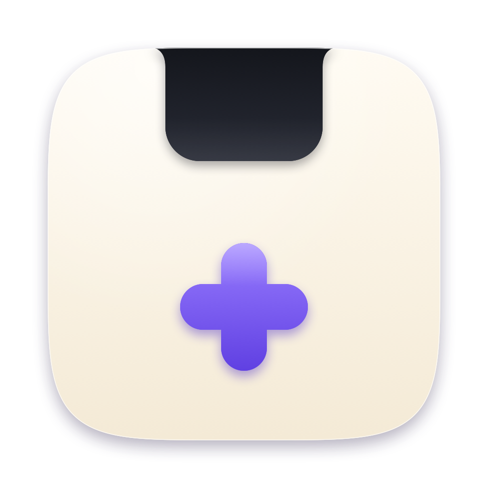

<p align="center">
  
</p>

<h1 align="center">Notch+</h1>

<p align="center">
  A small, calm island in your Mac's notch for the few things that need your attention.<br>
  Claude Code approvals, notifications that matter, a player and a file shelf. All on your Mac.
</p>

<p align="center">
  
  
  
</p>

<p align="center"><a href="docs/demo.mp4"><b>Watch the 43 second demo</b></a></p>

<!-- screenshot: add docs/screenshot.png and uncomment
<p align="center"></p>
-->

There are a lot of notch apps. Most try to do everything. Notch+ does a few things and does each one properly. It is built with Liquid Glass, and everything clever runs on-device with Apple Intelligence.

## Features

**Claude Code, from the notch.** Permission requests appear with a plain-words title, a risk label and the exact command. Allow, Always or Deny in one click, or with Option-Command-Y, A and N. Live status shows beside the notch while Claude works, and a card tells you when it finishes. If Notch+ is not running, Claude Code asks in the terminal as usual.

**Notifications that matter.** Notifications from every app, sorted by Apple Intelligence into now, later and noise, each with a one-line summary. Per-app control and Focus awareness.

**A player for anything.** Hover the notch while anything plays: cover glow, controls and a seek bar you can click and drag. Works with Music, Spotify, Podcasts and web video. Drag the player down to float it above your windows.

**A shelf for your files.** Drag files toward the notch and park them. Drag them out into any app, zip them, or run on-device actions: summarize, extract text, remove a background, transcribe audio and video, translate, convert. Ask a question about a PDF, text file, picture, audio or video. Files are never copied, moved or deleted.

**A basket.** Shake the mouse while dragging files and a basket appears under the pointer. Same actions, same Zip.

**Small tools.** Volume and brightness HUD, power alerts, a Caffeine switch to keep the Mac awake, and a one-click button that hides desktop files for clean screen recordings.

## Install

Requirements: a Mac with Apple silicon, macOS 26 or later, and the full Xcode (the command line tools alone are not enough).

```bash
git clone https://github.com/Nurik-dz/notch-plus.git
cd notch-plus
./build.sh
open Notch+.app
```

Then, in the gear menu or the menu bar item, open Settings:

- **Claude Code:** Connect. You see the exact change to `~/.claude/settings.json` first, and a backup is saved.
- **Notifications:** give Notch+ Full Disk Access so it can read the notification database. Apple Intelligence sorting needs a Mac that supports it.

## Use

| Do this | To get |
|---|---|
| Hover the notch, or swipe two fingers down over it | Open the island |
| Drag the player card down | A floating player |
| Drag files toward the notch | The shelf opens |
| Shake the mouse while dragging files | The basket |
| Eye, cup and gear buttons beside the notch | Clean desktop, Caffeine, Settings |

## Privacy

- Apple Intelligence runs on your Mac. Nothing is sent anywhere.
- The Claude Code hook listens on `127.0.0.1` only, with a secret token stored in an owner-only file.
- The shelf keeps links. Your files are never touched.

## Using Notch+? Help make it better

This is a young project and your feedback shapes it.

- [Report a bug](https://github.com/Nurik-dz/notch-plus/issues/new?template=bug.yml)
- [Suggest an idea](https://github.com/Nurik-dz/notch-plus/issues/new?template=idea.yml)

Please include your macOS version and Mac model. A screenshot or a short screen recording helps a lot.

## Build and test

```bash
./build.sh          # builds Notch+.app (ad-hoc signed)
./build.sh test     # compiles and runs the checks, about 5 minutes
open --env NOTCH_DEMO=1 Notch+.app    # a scripted tour with made-up data
```

Swift, SwiftUI and AppKit, compiled with `swiftc` through `build.sh`. Sources are in `Sources/`, the check harness in `Tests/`.

## Credits

Now-playing support uses [mediaremote-adapter](https://github.com/ungive/mediaremote-adapter) by Jonas van den Berg (BSD 3-Clause). See `Vendor/THIRD_PARTY.txt`.
