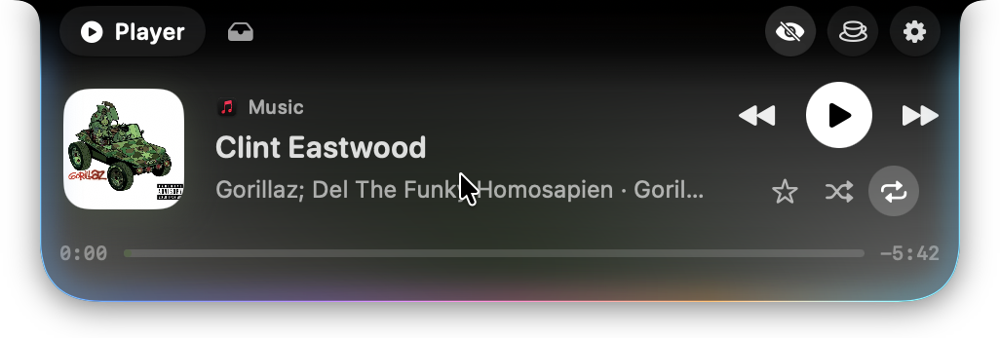
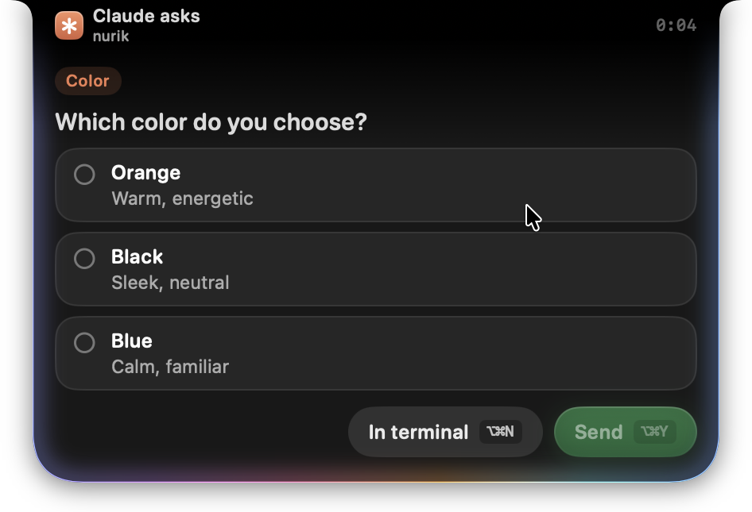
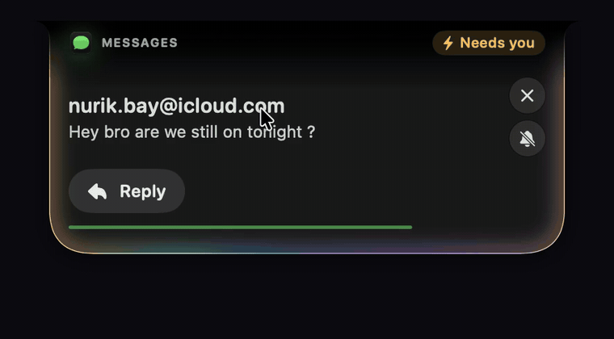
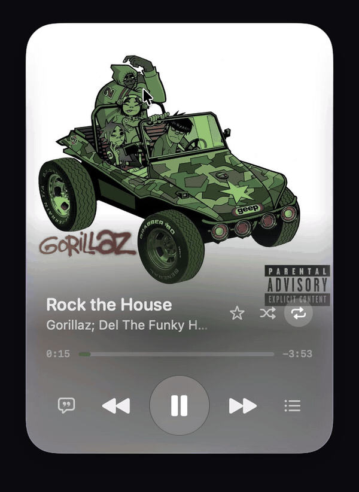
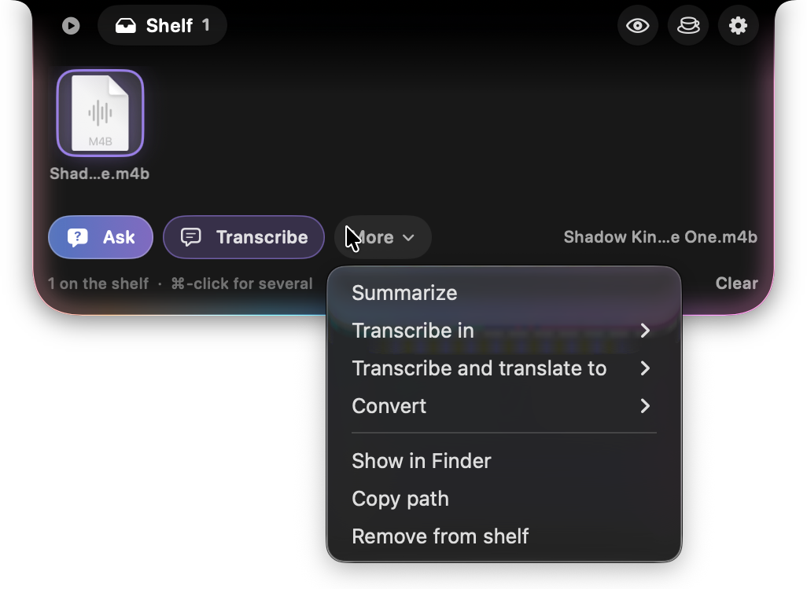
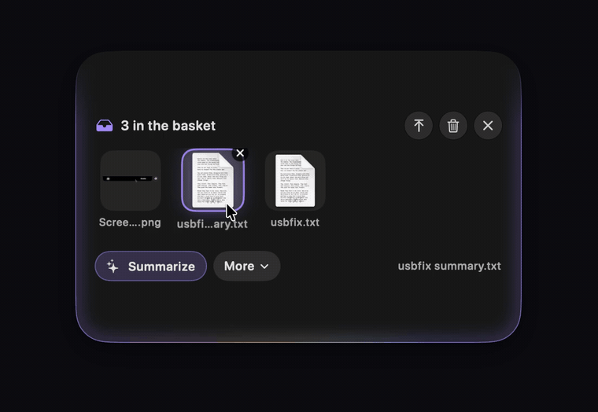

<p align="center">
  
</p>

<h1 align="center">Notch+</h1>

<p align="center">
  A small, calm island in your Mac's notch for the few things that need your attention.<br>
  Claude Code approvals, notifications that matter, a player and a file shelf. All on your Mac.
</p>

<p align="center">
  
  
  
</p>

<p align="center"><a href="https://notch-plus.pages.dev/"><b>Website</b></a></p>

<p align="center"></p>

There are a lot of notch apps. Most try to do everything. Notch+ does a few things and does each one properly. The island is black like the hardware notch and grows out of it (Liquid Glass is a choice in Settings), and everything clever runs on-device.

## Features

### Claude Code, from the notch

<p></p>

Permission requests appear with a plain-words title, a risk label and the exact command. Allow, Always or Deny in one click, or with Option-Command-Y, A and N. When Claude asks you a question, the options are on the card and you answer from the notch. Live status shows beside the notch while Claude works, and a card tells you when it finishes, with a button back to the right terminal tab. If a request waits too long, its timer turns amber and the island glows. If Notch+ is not running, Claude Code asks in the terminal as usual.

<br clear="right">

### Messages and notifications

<p></p>

Notifications from every app, with per-app control and Focus awareness. Messages show about a second after they arrive (macOS hands notifications over 8 to 13 seconds late, so Notch+ reads the message from Messages itself), and you can answer from the card, with suggested replies written in your own style. Apple Intelligence can label and summarize notifications. It is optional, runs on your Mac and never hides or delays one. A Recent list keeps the quiet ones.

<br clear="right">

### A player for anything

<p></p>

Hover the notch while anything plays: cover glow, controls and a seek bar you can click and drag. It works with Music, Spotify, Podcasts and web video. Drag the player down and it floats above your windows, in three sizes (double-click to change). In Apple Music the large size shows synced lyrics and the album's songs, and you can favourite, shuffle and repeat. Swipe two fingers left or right on the notch to skip, and the new song's name shows beside the notch when it changes. Lyrics and songs come from your own library, and only for songs that are files in it.

<br clear="right">

### A shelf for your files

<p></p>

Drag files toward the notch and park them. Drag them out into any app (several at once), zip them, or run on-device actions: summarize, extract text, remove a background, transcribe audio and video, translate, convert. Ask a question about a PDF, text file, picture, audio or video. Files are never copied, moved or deleted.

<br clear="right">

### A basket

<p></p>

Shake the mouse while dragging files and a basket appears under the pointer. Same actions, same Zip. It keeps its own list, and goes away by itself.

<br clear="right">

### Small tools

<p></p>

Volume and brightness bar, power alerts, a Caffeine switch to keep the Mac awake, and a one-click button that hides desktop files for clean screen recordings. Every extra is a switch in Settings.

<br clear="right">

## Install

Needs a Mac with Apple silicon and macOS 26 or later.

### Download

Get **Notch-Plus-0.2.dmg** from the [latest release](https://github.com/Nurik-dz/notch-plus/releases/latest), open it and drag Notch+ into Applications.

> **Notch+ is not notarized by Apple.** Notarizing needs a paid Apple Developer account, and I am not able to enroll in it. The app is signed ad-hoc and the full source is in this repository, so you can read it or build it yourself. The cost is a one-time warning on first launch:
>
> 1. Open Notch+. macOS says it could not verify it. Click **Done**.
> 2. Open **System Settings > Privacy & Security**, scroll to **Security**, click **Open Anyway** next to Notch+, enter your password and click **Open**.
>
> Or, in Terminal: `xattr -dr com.apple.quarantine /Applications/Notch+.app`

### Homebrew

```bash
brew tap Nurik-dz/notch-plus https://github.com/Nurik-dz/notch-plus
brew trust nurik-dz/notch-plus
brew install --cask notch-plus
```

Newer Homebrew asks you to trust a third-party tap before it loads anything from it, which is what the `brew trust` line does (older versions do not need it). The cask clears the quarantine flag for you, so there is no warning.

### Build it yourself

You need the full Xcode (the command line tools alone are not enough).

```bash
git clone https://github.com/Nurik-dz/notch-plus.git
cd notch-plus
./build.sh
open Notch+.app
```

### First steps

In the gear menu or the menu bar item, open Settings:

- **Claude Code:** Connect. You see the exact change to `~/.claude/settings.json` first, and a backup is saved.
- **Notifications:** give Notch+ Full Disk Access so it can read the notification database and Messages (the button opens the right page and shows the icon to drag in). Apple Intelligence labels and summaries need a Mac that supports it, and are optional.

## Use

| Do this | To get |
|---|---|
| Hover the notch, or swipe two fingers down over it | Open the island |
| Swipe two fingers left or right on the notch | Next or previous song |
| Drag the player card down, double-click it | A floating player, and its size |
| Drag files toward the notch | The shelf opens |
| Shake the mouse while dragging files | The basket |
| Eye, cup and gear buttons beside the notch | Clean desktop, Caffeine, Settings |

## Privacy

- Apple Intelligence runs on your Mac. Nothing is sent anywhere.
- The Claude Code hook listens on `127.0.0.1` only, with a secret token stored in an owner-only file.
- The shelf keeps links. Your files are never touched.

## Using Notch+? Help make it better

This is a young project and your feedback shapes it.

- [Report a bug](https://github.com/Nurik-dz/notch-plus/issues/new?template=bug.yml)
- [Suggest an idea](https://github.com/Nurik-dz/notch-plus/issues/new?template=idea.yml)

Please include your macOS version and Mac model. A screenshot or a short screen recording helps a lot.

## Build and test

```bash
./Scripts/make_dmg.sh   # the public download: dist/Notch-Plus-<version>.dmg, ad-hoc signed
./build.sh          # builds Notch+.app
./build.sh test     # compiles and runs the checks, about 5 minutes
open --env NOTCH_DEMO=1 Notch+.app    # a scripted tour with made-up data
```

`build.sh` signs the app with a certificate named "Notch+ Developer" when your keychain has one, and ad-hoc otherwise. With the certificate, macOS keeps Notch+'s permissions (such as Full Disk Access) when you rebuild; ad-hoc signed builds are treated as a new app every time and ask again.

Swift, SwiftUI and AppKit, compiled with `swiftc` through `build.sh`. Sources are in `Sources/`, the check harness in `Tests/`.

## Credits

Now-playing support uses [mediaremote-adapter](https://github.com/ungive/mediaremote-adapter) by Jonas van den Berg (BSD 3-Clause). See `Vendor/THIRD_PARTY.txt`.
